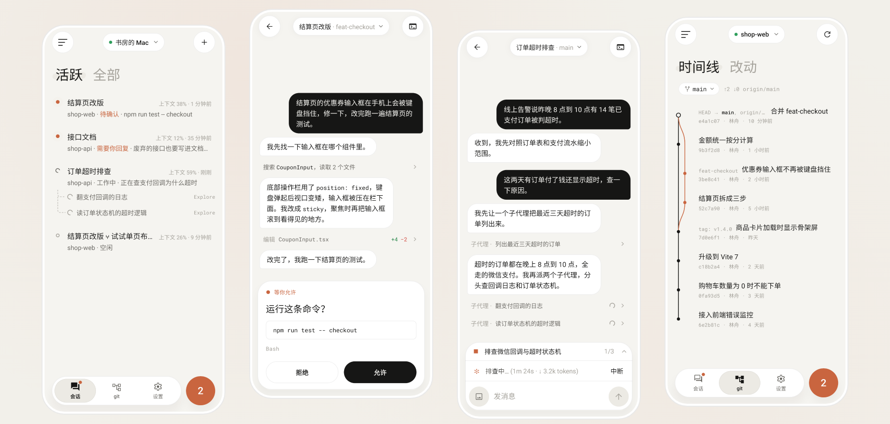
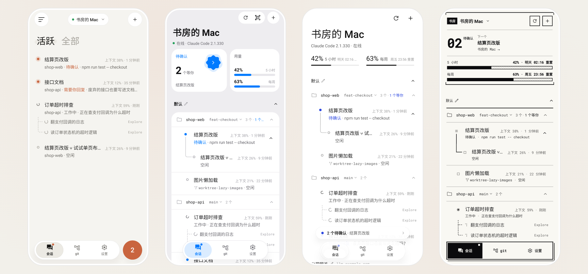

<p align="center">
  
</p>

<h1 align="center">clauderc</h1>

<p align="center">
  <strong>在手机上远程查看和操作电脑上的 Claude Code 后台会话</strong>
</p>

<p align="center">
  <a href="#功能一览">功能一览</a> ·
  <a href="#四套外观">四套外观</a> ·
  <a href="#快速开始">快速开始</a> ·
  <a href="#配置">配置</a> ·
  <a href="../../releases/latest">下载最新版</a>
</p>

<p align="center">
  <picture>
    <source media="(prefers-color-scheme: dark)" srcset="design/screenshots/cover-dark.png">
    
  </picture>
  <br>
  <sub>浮墨默认样式 · 会话列表 · 权限确认 · 子代理与任务清单 · Git 时间线</sub>
</p>

---

## 功能一览

<table>
  <tr>
    <td width="50%" valign="top">
      <h3>对话与待确认</h3>
      <ul>
        <li>实时看记录、发文字和图片，批准权限请求并回答单题或多题提问</li>
        <li>完整渲染 Markdown、表格、排版公式，点链接打开或复制，代码块一键复制，长按气泡选字</li>
        <li>左滑自己发过的消息可回溯到它之前，与电脑端 <code>/rewind</code> 一致，支持只回对话、只回代码或都回</li>
        <li>Claude Code 建了任务清单时输入框上方显示进度条，点开看全部（设了 <code>CLAUDE_CODE_TASK_LIST_ID</code>、多代理团队及 <code>TodoWrite</code> 会话不显示）</li>
      </ul>
    </td>
    <td width="50%" valign="top">
      <h3>会话与多机管理</h3>
      <ul>
        <li>底栏为「会话 / git / 设置」，页内随时切换多台目标机，跨机待确认一步直达</li>
        <li>按启动档位（接口地址）与工作目录双层分组，支持活跃筛选、分支标记与折叠</li>
        <li>新建会话可沿用已有档位、使用账户登录或自填接口地址与 API key，各档模型均可修改</li>
        <li>支持停止、移出、Fork 当前会话，或照当前会话在新的 worktree 中开启独立分支会话</li>
      </ul>
    </td>
  </tr>
  <tr>
    <td width="50%" valign="top">
      <h3>子代理、终端与额度</h3>
      <ul>
        <li>查看每个后台子代理正在做什么与执行详情，随时切入实时终端视图直接按键</li>
        <li>展示 Claude 账号的 5 小时额度、每周额度与每个会话的上下文占用</li>
        <li>撞到限额时显示重置倒计时，支持设置到点自动发一句话继续会话</li>
      </ul>
    </td>
    <td width="50%" valign="top">
      <h3>Git 工作流</h3>
      <ul>
        <li>浏览多分支提交时间线，查看提交详情与文件差异，支持沿父提交逐层回看</li>
        <li>在工作区按已暂存 / 未暂存管理改动，直接暂存、取消暂存与填写说明提交</li>
        <li>一键切换本地或远端分支、拉取与推送，目录选择器快速切换目标机上的最近目录</li>
      </ul>
    </td>
  </tr>
</table>

## 四套外观

内置 **浮墨、素卡、清玻、印版** 四套独立UI ：

<p align="center">
  <picture>
    <source media="(prefers-color-scheme: dark)" srcset="design/screenshots/styles-dark.png">
    
  </picture>
</p>

| 浮墨（默认） | 素卡 | 清玻 | 印版 |
|---|---|---|---|
| 深墨底配悬浮圆钮与陶土红点缀，露底推卡侧栏、手绘墨刷分页与原地展开的悬浮面板 | 暖灰底配纯白圆角便当块，双层曲奇徽章按压收圆回弹，柔和纯白底抽屉 | 纯白 / 纯黑纸面配通栏毛玻璃顶栏，顶落大圆角毛玻璃面板与延迟拉伸透镜 | 单色棉纸配八色油墨与四角裁切线，左印右抹纸条弹层，支持方形悬浮或贴底通栏底栏 |

> 浮墨、素卡、清玻支持默认点缀色、8 种预设主题色及 Android 12+ 壁纸动态取色；印版支持墨黑、群青、朱红、松绿、靛紫、赭石、茜红、橄榄 8 种油墨。

## 快速开始

```
手机 APP  ⇄  中转服务器 relay (公网 WSS)  ⇄  目标机 clauderc  ⇄  Claude Code 后台会话
```

| 程序 | 运行环境 | 职责 |
|---|---|---|
| **中转服务器 `relay`** | 有公网地址的 Linux 服务器（Docker + HTTPS 反向代理） | 手机与目标机都主动连它，负责认证与加密通道转发 |
| **目标机程序 `clauderc`** | 跑 Claude Code 的 macOS / Linux 电脑（Node.js 18+） | 发现后台会话、同步记录与用量，将手机操作转为按键 |
| **Android APP** | Android 10 或更新的手机 | 扫码配对后经中转服务器远程查看和操作会话 |

APK、各平台二进制与 `compose.yaml` 均在 [Releases](../../releases/latest) 发布，中转服务器镜像地址为 `ghcr.io/arcdent/clauderc-relay`。

**三步上手：**

1. 在服务器上用 Docker 启动中转服务器，并用反向代理转发 HTTPS / WebSocket
2. 在每台目标机运行 `npm i -g @arcdent/clauderc`，写好 `agent.toml`，执行 `clauderc start`
3. 手机安装 Releases 里的 APK，扫描电脑上 `clauderc pair` 显示的二维码完成配对

<details>
<summary><b>1. 部署中转服务器</b></summary>

服务器要有 Docker，amd64 或 arm64 都行。把地址换成自己的，一条命令拉镜像启动：

```sh
docker run -d --name clauderc-relay --restart unless-stopped \
  -e PUBLIC_URL=wss://relay.example.com -e TRUSTED_PROXIES=172.17.0.1/32 \
  -p 127.0.0.1:8787:8787 -v clauderc-relay:/data \
  ghcr.io/arcdent/clauderc-relay:latest
```

想用 Compose 管理，就把 Releases 里的 `compose.yaml` 放进服务器上的一个目录，比如 `/opt/clauderc-relay`，同目录写一个 `.env`：

```sh
PUBLIC_URL=wss://relay.example.com
```

然后在这个目录里运行 `docker compose up -d`，以后升级运行 `docker compose pull && docker compose up -d`。

本机有这个仓库时，部署脚本可以经 ssh 替你做完 Compose 这几步。它等健康检查通过后打印接下来要做的事，再运行一次就是升级。服务器要有 Compose v2，ssh 登录用户要能直接执行 docker：

```sh
scripts/deploy-relay.sh <ssh 主机> wss://relay.example.com
```

首次启动时，容器自动生成注册密钥，目标机凭它连接中转服务器。密钥和配对数据一起存在 Docker 卷里。

`.env` 和部署脚本可调的设置：

| 设置 | 默认 | 说明 |
|---|---|---|
| `.env` 的 `PUBLIC_URL` | 必填 | 手机和目标机使用的 `wss://` 地址 |
| `.env` 的 `RELAY_BIND` | `127.0.0.1:8787` | 服务在宿主机上监听的地址 |
| `.env` 的 `RELAY_IMAGE` | `ghcr.io/arcdent/clauderc-relay:latest` | 要运行的镜像，可以换成镜像站的地址，或固定版本如 `ghcr.io/arcdent/clauderc-relay:1.2.3` |
| `.env` 的 `TRUSTED_PROXIES` | `172.30.87.1/32` | 信任哪些地址发来的 `X-Forwarded-For`，多个网段用逗号或空格分开，单个地址写成 `/32`。默认是 Compose 网络的网关，宿主机上的反向代理从这个地址连进容器；设为空就不信任任何代理 |
| 本机环境变量 `SSH` | `ssh` | 部署脚本用的 ssh 命令，可以带参数，如 `SSH="ssh -p 2222"` |
| 本机环境变量 `REMOTE_DIR` | `/opt/clauderc-relay` | 部署脚本在服务器上用的目录 |
| 本机环境变量 `RELAY_IMAGE` | 不设置 | 设置后部署脚本把它写进服务器的 `.env` |

反向代理把 `https://relay.example.com` 转到 `127.0.0.1:8787`，要支持 WebSocket 升级。

Caddy 配置如下：

```
relay.example.com {
	reverse_proxy 127.0.0.1:8787
}
```

nginx 要带上升级头和 `X-Forwarded-For`：

```nginx
location / {
	proxy_pass http://127.0.0.1:8787;
	proxy_http_version 1.1;
	proxy_set_header Upgrade $http_upgrade;
	proxy_set_header Connection "upgrade";
	proxy_set_header X-Forwarded-For $proxy_add_x_forwarded_for;
	proxy_read_timeout 120s;
}
```

中转服务器按 `X-Forwarded-For` 分别统计每台手机的配对失败次数，Caddy 默认就会加这个头。上面 `docker run` 里的 `172.17.0.1` 是 Docker 默认网桥的网关，可用 `docker network inspect bridge` 核对。

`curl https://relay.example.com/healthz` 返回 200 说明服务正常。

不用 Docker 时，也可以直接运行 Releases 里的 `relay-linux-<架构>`：

1. 用 `openssl rand -hex 32` 生成注册密钥，存成 600 权限的文件
2. 按[配置](#配置)一节写 `relay.toml`
3. 运行 `relay serve --config <relay.toml 的路径>`

</details>

<details>
<summary><b>2. 安装目标机程序</b></summary>

需要 Node.js 18 或更新：

```sh
npm i -g @arcdent/clauderc
clauderc --version
```

npm 只装本机系统和架构对应的程序包，支持 macOS、Linux 的 x64 和 arm64。不用 npm 时，用 Releases 里的 `agent-<系统>-<架构>`，把下面命令里的 `clauderc` 换成它的文件名即可。

下面这条对应 Compose 部署在 `/opt/clauderc-relay`，用 `docker run` 部署时，把引号里的命令换成 `docker exec clauderc-relay cat /data/enroll.key`：

```sh
mkdir -p ~/.config/clauderc && (umask 077; ssh <ssh 主机> 'cd /opt/clauderc-relay && docker compose exec -T relay cat /data/enroll.key' > ~/.config/clauderc/enroll.key)
```

然后写 `~/.config/clauderc/agent.toml`：

```toml
relay_url = "wss://relay.example.com"
name = "书房的 Mac"
claude_path = "/Users/me/.nvm/versions/node/v22.23.2/bin/claude"
enroll_key_file = "/Users/me/.config/clauderc/enroll.key"
```

先在前台试跑，确认能连上，再放到后台运行：

```sh
clauderc run     # 前台运行，Ctrl+C 结束
clauderc start   # 在后台运行，关掉终端也不停
clauderc stop    # 结束后台运行
```

同一份配置只能运行一个，已经有一个在运行时，再执行 `clauderc run` 会提示它的进程号并退出。

后台运行的进程号和日志写在配置文件同目录的 `agent.pid`、`agent.log`。想开机自动运行，就装成服务，不要和 `clauderc start` 同时用：

```sh
clauderc service install            # 写服务文件并打印启用命令
clauderc service install --dry-run  # 只打印，不写文件
```

命令不会自己启用服务，按它打印的命令执行即可。服务文件和日志的位置：

| 系统 | 服务文件 | 日志 |
|---|---|---|
| macOS | `~/Library/LaunchAgents/clauderc.agent.plist` | `~/Library/Logs/clauderc-agent.log` |
| Linux | `~/.config/systemd/user/clauderc-agent.service` | |

Linux 上想在没登录时也运行，再执行一次 `loginctl enable-linger $USER`。

以服务方式运行前，先看这几条：

- 服务文件里写的是当前 Node.js 版本的 npm 全局目录下的程序路径。用 nvm 换了 Node.js 版本并在新版本下重装后，要再执行一次 `clauderc service install`，否则服务还在跑旧目录里的程序。
- 服务的 PATH 里通常找不到 nvm 装的 claude，所以 `claude_path` 要写绝对路径。
- 新建会话的接口、API key 和模型都在 APP 里填，服务的运行环境里不用配 `ANTHROPIC_BASE_URL` 这类变量。唤醒会话时用的是那个会话自己记下的启动参数。

</details>

<details>
<summary><b>3. 安装 APP 并配对</b></summary>

把 Releases 里的 APK 装到手机上。然后在任意一台目标机上运行：

```sh
clauderc pair
```

终端会显示二维码和截止时间，用 APP 扫码完成配对。配对码 5 分钟内有效，只能用一次。

```sh
clauderc devices         # 列出已配对的手机
clauderc revoke <id>     # 吊销一台手机，它的连接会立即断开
```

不想用了，停掉目标机上的服务，再在服务器上停掉容器：Compose 部署的在它的目录里运行 `docker compose down`，`docker run` 部署的运行 `docker rm -f clauderc-relay`。

</details>

## 配置

<details>
<summary><b>中转服务器 <code>relay.toml</code></b>（只在不用 Docker 时手写）</summary>

用 Docker 部署时，容器按 `PUBLIC_URL` 和 `TRUSTED_PROXIES` 自动生成这个文件，不用手写。

| 键 | 必填 | 说明 |
|---|---|---|
| `listen` | 否 | 本机监听地址，默认 `127.0.0.1:8787`。对外由反向代理提供 HTTPS |
| `public_url` | 是 | 手机和目标机使用的 `wss://` 地址，会直接写进配对二维码 |
| `enroll_key_file` | 是 | 注册密钥文件，权限必须是 600 或更严 |
| `state_file` | 是 | 状态文件路径，存目标机列表和已配对手机的凭证摘要，权限 600 |
| `trusted_proxies` | 否 | 可信代理的网段列表，如 `["172.30.87.1/32"]`。直连地址在这些网段里时，才按 `X-Forwarded-For` 认出手机的地址。回环地址总是可信，反向代理和中转服务器在同一台机器上直接运行时不用写 |

</details>

<details>
<summary><b>目标机 <code>agent.toml</code></b>（默认 <code>~/.config/clauderc/agent.toml</code>）</summary>

每个命令都可以用 `--config <路径>` 指定其他配置文件。

| 键 | 必填 | 说明 |
|---|---|---|
| `relay_url` | 是 | 中转服务器地址，只接受 `https://` 或 `wss://` |
| `name` | 否 | 手机上显示的名字，默认是主机名 |
| `claude_path` | 否 | claude 可执行文件，默认按 PATH 查找 `claude`。不能是会补参数的包装脚本 |
| `enroll_key_file` | 二选一 | 注册密钥文件，权限必须是 600 或更严 |
| `claude_dir` | 否 | Claude Code 的数据目录，默认 `~/.claude` |

注册密钥也可以用环境变量 `CLAUDERC_ENROLL_KEY` 提供，设置后优先于 `enroll_key_file`。

目标机程序会在 `agent.toml` 所在目录生成下面这些文件，都不需要手动改：

- `machine-id` 是这台目标机的标识，首次运行时生成。把配置拷到别的电脑时不要带上它，否则后运行的那台会被中转服务器拒绝
- `profiles.json` 记着见过的启动档位和每个档位最近一次的启动参数，会话全部移出后分组仍然显示，手机选档位新建时也从这里取接口和模型，权限 600
- `forks.json` 记着目标机替账户登录的会话 fork 出的副本各自的来源，会话页靠它把副本挂在来源下面
- `launch/` 放新建会话用的文件
  - 账户登录用的设置副本和自定义接口的 API key，权限 600
  - `launch/user-skills/` 里只有一个指向 `~/.claude/skills` 的软链，账户登录的会话靠它用上个人技能
- `agent.pid` 和 `agent.log` 是 `clauderc start` 在后台运行时的进程号和日志
- `agent.lock` 保证同一份配置只运行一个，里面写着正在运行的进程号

用账户登录新建的会话不读 `~/.claude/settings.json`，个人技能要靠 `launch/user-skills/` 接回来，而 Claude Code 只接受信任过的目录。第一次用账户登录新建会话时，目标机会在这个目录里替你点一次 Claude Code 的信任提示，之后的会话都带个人技能。万一自动信任没成功，这次新建会报错，按提示在目标机上进入 `launch/user-skills/` 运行一次 `claude`，选「Yes, I trust this folder」，再重新新建。

5 小时和每周用量是目标机程序拿 Claude Code 的登录凭证向 `api.anthropic.com` 查的。凭证在 macOS 上从钥匙串里的 `Claude Code-credentials` 读，其他情况读 `~/.claude/.credentials.json`。电脑上没有登录官方账号时，APP 不显示用量。

</details>

## 开发

构建、测试和开发规则见 [AGENTS.md](AGENTS.md)。

## 许可证

以 [AGPL-3.0](LICENSE) 许可证发布。
