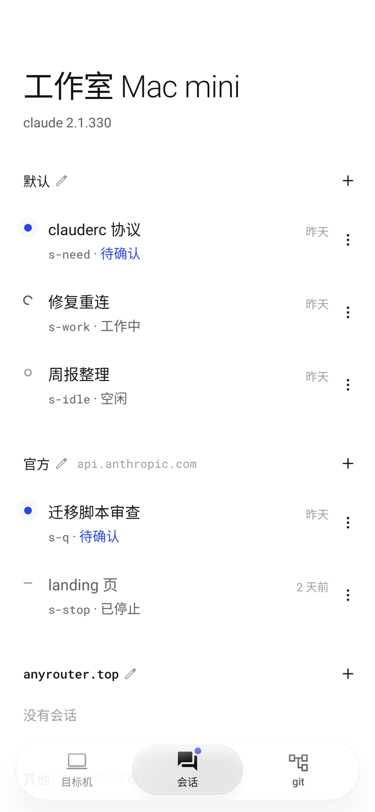
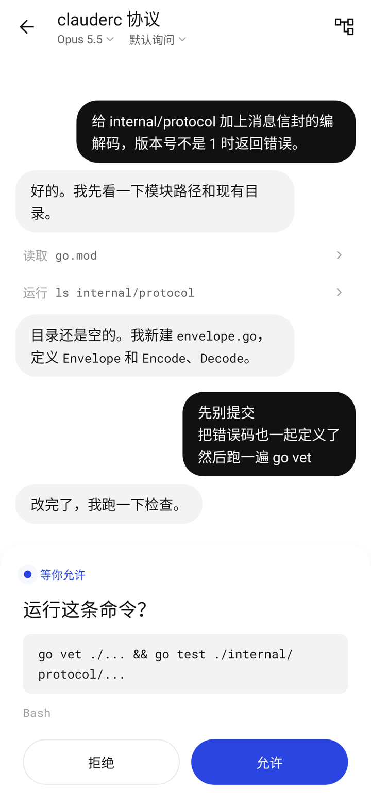
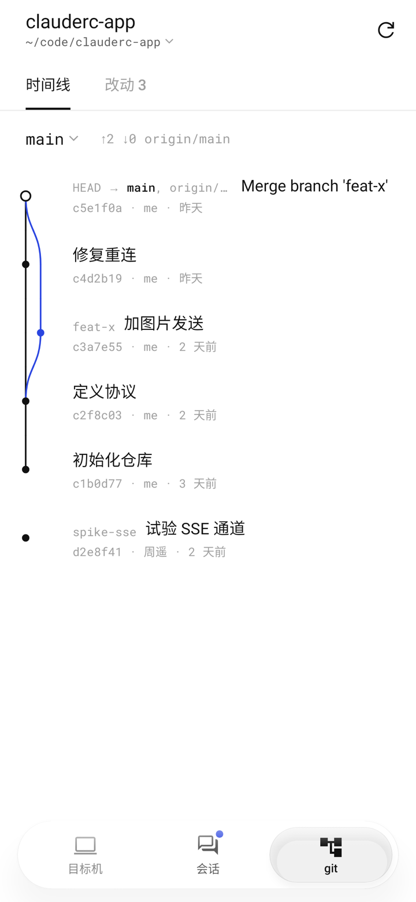

<h1 align="center">clauderc</h1>

<p align="center">在手机上查看和操作电脑上的 Claude Code 后台会话</p>

<p align="center">
  <a href="#快速开始">快速开始</a> ·
  <a href="#配置">配置</a>
</p>

<p align="center">
  <picture>
    <source media="(prefers-color-scheme: dark)" srcset="design/screenshots/sessions-dark.png">
    
  </picture>
  <picture>
    <source media="(prefers-color-scheme: dark)" srcset="design/screenshots/permission-dark.png">
    
  </picture>
  <picture>
    <source media="(prefers-color-scheme: dark)" srcset="design/screenshots/git-log-dark.png">
    
  </picture>
</p>

## 能做什么

- 看对话、发消息，回答 claude 的权限请求和提问
- 新建和停止会话，会话先按启动档位分组，档位里再按工作目录分组，档位就是会话启动时用的接口地址
- 看电脑上登录的 Claude 账号用了多少 5 小时额度和每周额度，以及每个会话的上下文占了多少
- 看 git 提交历史，暂存、提交、拉取和推送
- 在设置里切换极简或卡片样式、浅色或深色，卡片样式还能换主题色或跟随壁纸取色

## 快速开始

整套东西由三个程序组成：

| 程序 | 装在哪 | 做什么 |
|---|---|---|
| 中转服务器 `relay` | 有公网地址的 Linux 服务器，装有 Docker，前面要有提供 HTTPS 的反向代理 | 手机和电脑都主动连它，它负责认证和转发 |
| 目标机程序 `clauderc` | 每台跑 Claude Code 的电脑，macOS 或 Linux，要有 Node.js 18 或更新 | 读取后台会话，把手机上的操作换成按键敲进会话 |
| Android APP | Android 10 或更新的手机 | 扫码配对后连中转服务器 |

APK、各平台的二进制和 `compose.yaml` 都在 [Releases](../../releases/latest) 页面下载，中转服务器的镜像是 `ghcr.io/arcdent/clauderc-relay`。

1. 在服务器上用 Docker 拉起中转服务器，再让反向代理转到它
2. 每台电脑运行 `npm i -g @arcdent/clauderc`，写好 `agent.toml`，运行 `clauderc start` 在后台运行
3. 手机装上 Releases 里的 APK，扫 `clauderc pair` 显示的二维码

<details>
<summary><b>1. 部署中转服务器</b></summary>

服务器要有 Docker，amd64 或 arm64 都行。把地址换成自己的，一条命令拉镜像启动：

```sh
docker run -d --name clauderc-relay --restart unless-stopped \
  -e PUBLIC_URL=wss://relay.example.com \
  -p 127.0.0.1:8787:8787 -v clauderc-relay:/data \
  ghcr.io/arcdent/clauderc-relay:latest
```

想用 Compose 管理，就把 Releases 里的 `compose.yaml` 放进服务器上的一个目录，比如 `/opt/clauderc-relay`，同目录写一个 `.env`：

```sh
PUBLIC_URL=wss://relay.example.com
```

然后在这个目录里运行 `docker compose up -d`，以后升级运行 `docker compose pull && docker compose up -d`。

本机有这个仓库时，部署脚本可以经 ssh 替你做完 Compose 这几步。它等健康检查通过后打印接下来要做的事，再运行一次就是升级。服务器要有 Compose v2，ssh 登录用户要能直接执行 docker：

```sh
scripts/deploy-relay.sh <ssh 主机> wss://relay.example.com
```

首次启动时，容器自动生成注册密钥，目标机凭它连接中转服务器。密钥和配对数据一起存在 Docker 卷里。

`.env` 和部署脚本可调的设置：

| 设置 | 默认 | 说明 |
|---|---|---|
| `.env` 的 `PUBLIC_URL` | 必填 | 手机和目标机使用的 `wss://` 地址 |
| `.env` 的 `RELAY_BIND` | `127.0.0.1:8787` | 服务在宿主机上监听的地址 |
| `.env` 的 `RELAY_IMAGE` | `ghcr.io/arcdent/clauderc-relay:latest` | 要运行的镜像，可以换成镜像站的地址，或固定版本如 `ghcr.io/arcdent/clauderc-relay:1.2.3` |
| 本机环境变量 `SSH` | `ssh` | 部署脚本用的 ssh 命令，可以带参数，如 `SSH="ssh -p 2222"` |
| 本机环境变量 `REMOTE_DIR` | `/opt/clauderc-relay` | 部署脚本在服务器上用的目录 |
| 本机环境变量 `RELAY_IMAGE` | 不设置 | 设置后部署脚本把它写进服务器的 `.env` |

反向代理把 `https://relay.example.com` 转到 `127.0.0.1:8787`，要支持 WebSocket 升级。

Caddy 配置如下：

```
relay.example.com {
	reverse_proxy 127.0.0.1:8787
}
```

nginx 要带上升级头：

```nginx
location / {
	proxy_pass http://127.0.0.1:8787;
	proxy_http_version 1.1;
	proxy_set_header Upgrade $http_upgrade;
	proxy_set_header Connection "upgrade";
	proxy_read_timeout 120s;
}
```

`curl https://relay.example.com/healthz` 返回 200 说明服务正常。

不用 Docker 时，也可以直接运行 Releases 里的 `relay-linux-<架构>`：

1. 用 `openssl rand -hex 32` 生成注册密钥，存成 600 权限的文件
2. 按[配置](#配置)一节写 `relay.toml`
3. 运行 `relay serve --config <relay.toml 的路径>`

</details>

<details>
<summary><b>2. 安装目标机程序</b></summary>

需要 Node.js 18 或更新：

```sh
npm i -g @arcdent/clauderc
clauderc --version
```

npm 只装本机系统和架构对应的程序包，支持 macOS、Linux 的 x64 和 arm64。不用 npm 时，用 Releases 里的 `agent-<系统>-<架构>`，把下面命令里的 `clauderc` 换成它的文件名即可。

下面这条对应 Compose 部署在 `/opt/clauderc-relay`，用 `docker run` 部署时，把引号里的命令换成 `docker exec clauderc-relay cat /data/enroll.key`：

```sh
mkdir -p ~/.config/clauderc && (umask 077; ssh <ssh 主机> 'cd /opt/clauderc-relay && docker compose exec -T relay cat /data/enroll.key' > ~/.config/clauderc/enroll.key)
```

然后写 `~/.config/clauderc/agent.toml`：

```toml
relay_url = "wss://relay.example.com"
name = "书房的 Mac"
claude_path = "/Users/me/.nvm/versions/node/v22.23.2/bin/claude"
enroll_key_file = "/Users/me/.config/clauderc/enroll.key"
```

先在前台试跑，确认能连上，再放到后台运行：

```sh
clauderc run     # 前台运行，Ctrl+C 结束
clauderc start   # 在后台运行，关掉终端也不停
clauderc stop    # 结束后台运行
```

同一份配置只能运行一个，已经有一个在运行时，再执行 `clauderc run` 会提示它的进程号并退出。

后台运行的进程号和日志写在配置文件同目录的 `agent.pid`、`agent.log`。想开机自动运行，就装成服务，不要和 `clauderc start` 同时用：

```sh
clauderc service install            # 写服务文件并打印启用命令
clauderc service install --dry-run  # 只打印，不写文件
```

命令不会自己启用服务，按它打印的命令执行即可。服务文件和日志的位置：

| 系统 | 服务文件 | 日志 |
|---|---|---|
| macOS | `~/Library/LaunchAgents/clauderc.agent.plist` | `~/Library/Logs/clauderc-agent.log` |
| Linux | `~/.config/systemd/user/clauderc-agent.service` | |

Linux 上想在没登录时也运行，再执行一次 `loginctl enable-linger $USER`。

以服务方式运行前，先看这几条：

- 服务文件里写的是当前 Node.js 版本的 npm 全局目录下的程序路径。用 nvm 换了 Node.js 版本并在新版本下重装后，要再执行一次 `clauderc service install`，否则服务还在跑旧目录里的程序。
- 服务的 PATH 里通常找不到 nvm 装的 claude，所以 `claude_path` 要写绝对路径。
- `claude_path` 要指向 claude 本身，不能是会自动补参数的包装脚本。唤醒已停止的会话时，命令只能是 `claude --bg --resume <会话 id>`，多一个参数，Claude Code 就会另起一个新会话。
- 某个档位如果靠 `ANTHROPIC_BASE_URL` 这类环境变量指定接口，要把这些变量配进服务的运行环境。因为新建和唤醒会话时，用的是目标机程序自己的环境变量，加上该档位最近一个会话记下的模型设置。macOS 写在 plist 的 `EnvironmentVariables` 里，Linux 写在单元文件的 `Environment=` 里。用 `--settings` 指定接口的档位不受影响。

</details>

<details>
<summary><b>3. 安装 APP 并配对</b></summary>

把 Releases 里的 APK 装到手机上。然后在任意一台目标机上运行：

```sh
clauderc pair
```

终端会显示二维码和截止时间，用 APP 扫码完成配对。配对码 5 分钟内有效，只能用一次。

```sh
clauderc devices         # 列出已配对的手机
clauderc revoke <id>     # 吊销一台手机，它的连接会立即断开
```

不想用了，停掉目标机上的服务，再在服务器上停掉容器：Compose 部署的在它的目录里运行 `docker compose down`，`docker run` 部署的运行 `docker rm -f clauderc-relay`。

</details>

## 配置

<details>
<summary>中转服务器 <code>relay.toml</code>，只在不用 Docker 时手写</summary>

用 Docker 部署时，容器按 `PUBLIC_URL` 自动生成这个文件，不用手写。

| 键 | 必填 | 说明 |
|---|---|---|
| `listen` | 否 | 本机监听地址，默认 `127.0.0.1:8787`。对外由反向代理提供 HTTPS |
| `public_url` | 是 | 手机和目标机使用的 `wss://` 地址，会直接写进配对二维码 |
| `enroll_key_file` | 是 | 注册密钥文件，权限必须是 600 或更严 |
| `state_file` | 是 | 状态文件路径，存目标机列表和已配对手机的凭证摘要，权限 600 |

</details>

<details>
<summary>目标机 <code>agent.toml</code></summary>

默认路径 `~/.config/clauderc/agent.toml`，每个命令都可以用 `--config <路径>` 指定。

| 键 | 必填 | 说明 |
|---|---|---|
| `relay_url` | 是 | 中转服务器地址，只接受 `https://` 或 `wss://` |
| `name` | 否 | 手机上显示的名字，默认是主机名 |
| `claude_path` | 否 | claude 可执行文件，默认按 PATH 查找 `claude`；不能是会补参数的包装脚本 |
| `enroll_key_file` | 二选一 | 注册密钥文件，权限必须是 600 或更严 |
| `claude_dir` | 否 | Claude Code 的数据目录，默认 `~/.claude` |

注册密钥也可以用环境变量 `CLAUDERC_ENROLL_KEY` 提供，设置后优先于 `enroll_key_file`。

目标机程序会在 `agent.toml` 所在目录生成下面这些文件，都不需要手动改：

- `machine-id` 是这台目标机的标识，首次运行时生成。把配置拷到别的电脑时不要带上它，否则后运行的那台会被中转服务器拒绝
- `profiles.json` 记着每个启动档位最近一次的启动参数，权限 600
- `agent.pid` 和 `agent.log` 是 `clauderc start` 在后台运行时的进程号和日志
- `agent.lock` 保证同一份配置只运行一个，里面写着正在运行的进程号

5 小时和每周用量是目标机程序拿 Claude Code 的登录凭证向 `api.anthropic.com` 查的。凭证在 macOS 上从钥匙串里的 `Claude Code-credentials` 读，其他情况读 `~/.claude/.credentials.json`。电脑上没有登录官方账号时，APP 不显示用量。

</details>

APP 没有配置文件。中转服务器地址和凭证都从配对二维码里得到。档位名和外观在 APP 里改，只保存在这台手机上。

## 开发

构建、测试和开发规则见 [AGENTS.md](AGENTS.md)。

## 许可证

以 AGPL-3.0 许可证发布。
